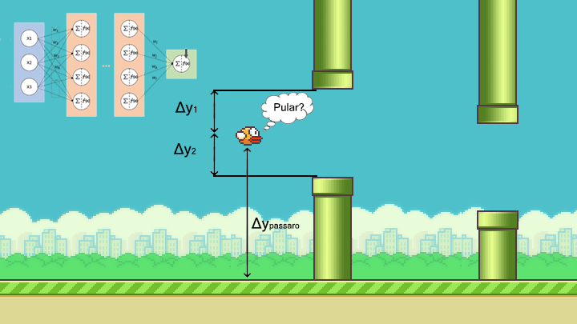

# Flappy Bird com redes neurais e algoritmo genético

Trabalho acadêmico desenvolvido na UFRJ para estudar neuroevolução com NEAT. Cada pássaro é controlado por uma rede neural; a população evolui conforme a aptidão dos indivíduos no jogo.

## Instalação

O ambiente validado para esta reorganização utiliza Python 3.11.8. As versões das dependências estão registradas em `requirements.txt`. O `neat-python` foi fixado em **0.92**, validado com os três checkpoints históricos; a versão 2.0 consegue abri-los, mas falha ao evoluir suas conexões antigas.

```powershell
python -m venv .venv
.\.venv\Scripts\python.exe -m pip install -r requirements.txt
.\.venv\Scripts\python.exe main.py
```

Para gerar a topologia da rede, instale também o [Graphviz](https://graphviz.org/download/) no sistema e disponibilize o comando `dot` no PATH. O pacote Python `graphviz` sozinho não instala esse executável. Quando `dot` não está disponível, o programa preserva a fonte da topologia em DOT e gera os demais gráficos normalmente. Use `--sem-graficos` para executar somente o treinamento.

## Execução

```powershell
python main.py
python main.py --cenario 1 --do-zero --geracoes 50
python main.py --cenario 2 --sem-graficos
python main.py --cenario 3 --checkpoint "checkpoints/historicos/3-neat-checkpoint"
python main.py --help
```

Por padrão, o programa usa o cenário 3, tenta restaurar seu checkpoint histórico e executa até 50 gerações adicionais. Se o checkpoint padrão não existir, inicia uma nova população. O NEAT pode finalizar antes ao atingir o limiar de fitness configurado. Fechar a janela encerra a execução.

`--do-zero` inicia uma população com `config/neat.ini`. Ao retomar um checkpoint, valem os parâmetros armazenados nele. Os checkpoints preservam uma **população**, não apenas o melhor agente. Não foi acrescentado um modo separado de demonstração sem evolução.

Os caminhos dos recursos são resolvidos a partir do projeto: também é possível executar `main.py` por seu caminho absoluto a partir de outra pasta.

## Cenários

| Cenário | Comportamento |
| --- | --- |
| 1 | Canos com altura sorteada e deslocamento horizontal |
| 2 | Acrescenta movimento vertical dos canos |
| 3 | Acrescenta aceleração dos novos canos e do chão |

## Rede neural e fitness

Cada indivíduo recebe três entradas:

1. Coordenada vertical do pássaro (`passaro.y`).
2. Diferença entre essa coordenada e `cano.altura`.
3. Diferença entre essa coordenada e a posição da base do cano (`cano.pos_base`).



A figura é uma ilustração do trabalho original; a lista acima descreve as entradas efetivamente usadas. No cenário com movimento vertical, `cano.altura` mantém a altura inicialmente sorteada, enquanto `pos_base` acompanha o movimento. Essa regra original foi preservada.

A rede possui uma saída: o pássaro pula quando o valor ultrapassa **0,5**. A configuração inicia sem neurônios ocultos, e o NEAT pode adicionar ou remover nós e conexões. A ativação padrão é `tanh`, com `tanh` e `sigmoid` disponíveis para mutação.

O fitness recebe **0,1 por frame vivo**, **5 ao passar um cano** e uma penalidade de **1 por colisão com cano**. Os parâmetros do jogo ficam em `flappy_bird/configuracao.py`; os parâmetros evolutivos ficam em `config/neat.ini`.

## Organização

```text
main.py                      Interface de execução
flappy_bird/
    configuracao.py          Parâmetros e caminhos
    jogo.py                  Simulação, avaliação e renderização
    treinamento.py           População NEAT, evolução e checkpoints
    visualizacao.py          Gráficos e topologia
    entidades/               Pássaro, cano e chão
config/neat.ini              Configuração NEAT
assets/imagens/              Imagens do jogo
docs/                        Relatório e ilustrações
resultados/cenario_1/        Resultados históricos do cenário 1
resultados/cenario_2/        Resultados históricos do cenário 2
resultados/cenario_3/        Resultados históricos do cenário 3
resultados/execucoes/        Gráficos de novas execuções
checkpoints/historicos/      Populações preservadas do trabalho
checkpoints/execucoes/       Checkpoints de novas execuções
```

Novas saídas são separadas por cenário e identificador de execução. Checkpoints são gravados a cada quatro gerações ou pelo intervalo de tempo do reporter (cinco segundos, verificado ao final da geração). Fechar a janela durante uma geração não salva um checkpoint adicional.

Os resultados históricos são mantidos no repositório; as saídas de novas execuções e os caches Python são ignorados pelo Git.

## Material do trabalho

- [Relatório acadêmico](docs/trabalho_final.pdf)
- [Resultados do cenário 1](resultados/cenario_1/)
- [Resultados do cenário 2](resultados/cenario_2/)
- [Resultados do cenário 3](resultados/cenario_3/)

Os gráficos existentes foram preservados, incluindo seus nomes originais. Eles representam as execuções do trabalho, e não uma nova comparação experimental.

## Referências

- [Documentação do NEAT-Python](https://neat-python.readthedocs.io/en/latest/)
- [Tech With Tim](https://www.youtube.com/watch?v=MMxFDaIOHsE&ab_channel=TechWithTim)
- [Hashtag Programação](https://www.youtube.com/watch?v=GMDb2jtzKZQ&t=1514s&ab_channel=HashtagPrograma%C3%A7%C3%A3o)
- [How I Built an AI to Play Flappy Bird](https://medium.com/analytics-vidhya/how-i-built-an-ai-to-play-flappy-bird-81b672b66521)

## Validação automatizada

```powershell
.\.venv\Scripts\python.exe -m unittest discover -s tests -v
```

Os testes usam vídeo virtual, limitam cada avaliação a 120 frames e verificam evolução de uma geração nos três cenários, com populações novas e checkpoints históricos. Também verificam gráficos de fitness/espécies e encerramento da janela. Isso não substitui a inspeção visual do jogo nem um treinamento completo.
